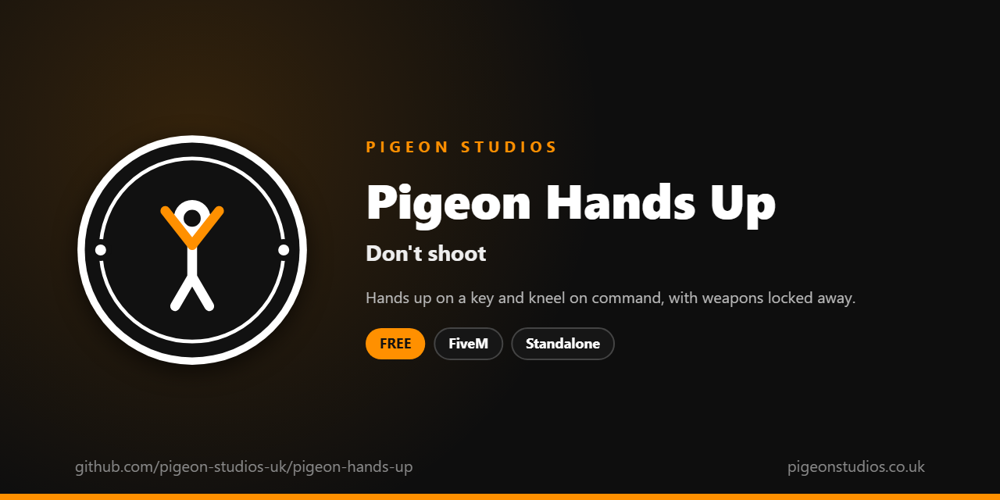

<div align="center">
  

  <h1>Pigeon Hands Up</h1>

  <p><strong>Hands up on a key, and kneel with your hands behind your head, with weapons locked away and a state bag for police resources.</strong></p>

  <p>
    <a href="https://github.com/pigeon-studios-uk/pigeon-hands-up/releases/latest"></a>
    <a href="LICENSE.md"></a>
    <a href="https://discord.gg/2NFVWEUmDF"></a>
    
  </p>

  <p>
    <a href="https://github.com/pigeon-studios-uk/pigeon-hands-up/releases/latest"><strong>Download</strong></a> ·
    <a href="#installation">Install</a> ·
    <a href="#configuration">Configure</a> ·
    <a href="CHANGELOG.md">Changelog</a> ·
    <a href="https://discord.gg/2NFVWEUmDF">Support</a>
  </p>
</div>

---

## Contents

- [Overview](#overview)
- [Features](#features)
- [Requirements](#requirements)
- [Installation](#installation)
- [Updating](#updating)
- [Configuration](#configuration)
- [Localisation](#localisation)
- [Commands and exports](#commands-and-exports)
- [How it works](#how-it-works)
- [Update checker](#update-checker)
- [Performance](#performance)
- [Security](#security)
- [Troubleshooting](#troubleshooting)
- [FAQ](#faq)
- [Support](#support)
- [Contributing](#contributing)
- [Licence](#licence)
- [Credits](#credits)

## Overview

Pigeon Hands Up is a free resource by [Pigeon Studios](https://pigeonstudios.co.uk) that gives players a key to put their hands up. Traffic stops, robberies, standoffs and arrests all need a quick, clear way to surrender that everyone can see, without opening an emote menu.

Press X and the character raises their hands; press it again to lower them. `/kneel` gets them down on their knees with their hands behind their head, the way police ask for it. While their hands are up they can't shoot, aim, punch or pick a weapon, and while they're kneeling they can't move either. Police and robbery resources can see who has their hands up through a state bag or two exports.

## Features

- **One key.** X by default, which players can change in GTA's key bindings, or `/handsup`.
- **Kneel.** `/kneel`, or a key players choose, kneels with hands behind the head, and gets up again.
- **Weapons locked away.** No shooting, aiming, melee or weapon wheel while surrendering.
- **Walk with hands up.** On by default, or keep them standing still.
- **Seen by everyone.** GTA's own animations, synced by the game.
- **For police resources.** A replicated `handsUp` state bag, and `IsHandsUp` and `IsKneeling` exports.
- **Ends by itself.** Getting knocked over, dying, getting into a vehicle or another animation lets go.
- **23 languages.** Follows ox_lib's language, or set your own.
- **Standalone.** No framework or other resources needed.

## Requirements

| Requirement | Version | Notes |
|---|---|---|
| FXServer | A [recommended artifact](https://runtime.fivem.net/artifacts/) | |
| [ox_lib](https://github.com/communityox/ox_lib) | Optional | Used for messages and the language if it's running |

**Frameworks:** none needed. It works the same on standalone and vMenu servers, ESX Legacy, QBCore, Qbox and ox_core.

## Installation

1. **Download** `pigeon-hands-up.zip` from the [latest release](https://github.com/pigeon-studios-uk/pigeon-hands-up/releases/latest). Don't use the green **Code** button; release zips are the tested builds.
2. **Extract** it into your server's `resources` folder. The folder must be called `pigeon-hands-up`.
3. **Start it** by adding this to `server.cfg`, after ox_lib if you use it:

   ```cfg
   ensure pigeon-hands-up
   ```

4. **Configure** it in `configuration/config.lua` if you want to change anything. The defaults work as they are.
5. **Restart** your server. The console shows one line from the update checker:

   ```text
   [Pigeon Studios] Pigeon Hands Up v1.0.0 is up to date.
   ```

## Updating

1. Read the [changelog](CHANGELOG.md) for every version between yours and the latest, especially any **Upgrade notes**.
2. Back up your `configuration/` and `locales/` folders.
3. Replace the `pigeon-hands-up` folder with the new release.
4. Copy your changed settings into the new `configuration/config.lua`. Don't copy the old file over the new one; new versions can add settings.
5. Restart the resource.

## Configuration

All settings are in `configuration/config.lua`, each explained by a comment next to it.

| Setting | Default | What it does |
|---|---|---|
| `Config.Locale` | `'auto'` | The language. `'auto'` follows ox_lib's; or a code such as `'de'` (see [Localisation](#localisation)) |
| `Config.HandsUpKey` | `'X'` | The default key for hands up. Players can change it in GTA's key bindings |
| `Config.HandsUpCommand` | `'handsup'` | The command, which the key runs |
| `Config.KneelKey` | `''` | The default key for kneeling. `''` leaves it unbound until a player picks one |
| `Config.KneelCommand` | `'kneel'` | The kneel command, which always works |
| `Config.WalkWithHandsUp` | `true` | Players can walk with their hands up. `false` keeps them standing still |
| `Config.ShowMessages` | `true` | Tell players when they can't put their hands up |
| `Config.Notifications` | `'auto'` | `'auto'` (ox_lib if it's running), `'ox_lib'` or `'gta'` |

## Localisation

Pigeon Hands Up comes in 23 languages: `en` English, `cs` Czech, `da` Danish, `de` German, `es` Spanish, `et` Estonian, `fi` Finnish, `fr` French, `hr` Croatian, `hu` Hungarian, `id` Indonesian, `it` Italian, `nl` Dutch, `no` Norwegian, `pl` Polish, `pt` Portuguese, `pt-br` Brazilian Portuguese, `ro` Romanian, `sl` Slovenian, `sv` Swedish, `tr` Turkish, `zh-cn` Simplified Chinese and `zh-tw` Traditional Chinese. They're the languages ox_lib ships, so your server may already have one set.

With `Config.Locale = 'auto'` (the default), it uses ox_lib's language, so one line in `server.cfg` sets it for this and every other resource that follows ox_lib:

```cfg
setr ox:locale "de"
```

Use `setr`, not `set`, so players' games get it too. Without it, or for a language that isn't in `locales/`, the text is English. To choose a language for this resource only, set `Config.Locale` to its code, such as `'fr'` or `'pt-br'`.

The key binding names in GTA's settings are set the first time a player joins, in the language the server had then. Chinese text can show as blank in GTA's own text, such as its notifications, because GTA only loads its Chinese font when the game itself is set to Chinese. ox_lib's notifications show every language.

Every file was checked for missing text and placeholders, but not every translation has been read by a native speaker yet. If something reads wrong, please send a fix; see [Contributing](#contributing). To add a language, copy `locales/en.lua` to a new file named with the language's code (such as `ja.lua`), change `Locales.en` at the top to match (`Locales.ja`), and translate the text in quotes.

## Commands and exports

### Commands

| Command | Who | What it does |
|---|---|---|
| `/handsup` | Everyone | Hands up, or down again. While kneeling, gets up. The X key runs it |
| `/kneel` | Everyone | Kneel with hands behind the head, or get up again |

### Exports

Client exports, for other resources in the player's game:

```lua
-- True while the player's hands are up, standing or kneeling.
local surrendering = exports['pigeon-hands-up']:IsHandsUp()

-- True while the player is kneeling.
local kneeling = exports['pigeon-hands-up']:IsKneeling()
```

### State bag

Every player has a replicated `handsUp` state bag, so the server and other players' resources can read it too. It's `'up'`, `'kneel'` or `nil`:

```lua
-- Server: can this player be searched or cuffed without a fight?
local pose = Player(source).state.handsUp

-- Client: has the player I'm looking at got their hands up?
local pose = Player(GetPlayerServerId(NetworkGetPlayerIndexFromPed(ped))).state.handsUp
```

## How it works

When the player presses the key, the resource checks they're on foot, not swimming, falling, ragdolled or dead. Then it plays GTA's hands-up animation (`missminuteman_1ig_2`) on the upper body only, so they can still walk, or on its own if `Config.WalkWithHandsUp` is off. Kneeling plays GTA's arrest animations (`random@arrests`): getting down, a kneeling loop, and getting up.

While the hands are up, every frame the resource turns off the controls for shooting, aiming, melee and the weapon wheel, and while kneeling also the ones for moving, sprinting and jumping. If something else ends the animation, such as being knocked over, dying, getting into a vehicle or another resource playing an animation, the resource notices and lets go.

Animations are synced by the game itself, so everyone sees them. The only thing the resource shares is the `handsUp` state bag.

## Update checker

When it starts, Pigeon Hands Up checks our public [version registry](https://github.com/pigeon-studios-uk/pigeon-versions) once and prints one line in the server console saying whether it's up to date. If there's an update, it shows what's new and where to get it. The check is a single request to GitHub and sends nothing about your server or players.

Control it for every Pigeon Studios resource at once in `server.cfg`:

```cfg
set pigeon_update_check "on"      # default: one line per resource
set pigeon_update_check "quiet"   # only when there's an update or a problem
set pigeon_update_check "off"     # never check
```

## Performance

When the hands are down, it checks four times a second whether anything has changed and does nothing else. While they're up, it turns off a handful of controls each frame, which costs next to nothing. Nothing runs on the server apart from the update check at start-up.

## Security

- It runs only in each player's own game and only changes their own character.
- It has no network events, so there is nothing other players or the server can send it. The exports can only be called by resources in the player's own game.
- The `handsUp` state bag is set by the player's own game, so treat it like anything else a player's game says: fine for roleplay checks, but don't base anything important, such as handing over items, on it alone.
- The only network request is the update check at start-up, from the server to GitHub. It sends nothing about your server or players.

Found a problem? Please don't open a public issue. Use the **Report a vulnerability** button in this repository's **Security** tab, or follow our [Security Policy](https://github.com/pigeon-studios-uk/.github/blob/main/SECURITY.md).

## Troubleshooting

**Nothing happens when I press X.**
Check the key in **Settings → Key Bindings → FiveM → Hands up / down**; if another resource uses X, change one of them. Try `/handsup`; if that shows a message, it says why.

**The hands drop by themselves.**
Another resource played an animation on the character, such as an emote menu or a phone. That ends hands up, the same as it would for any emote. Put the hands up again afterwards.

**Players can still shoot with their hands up.**
Make sure no other resource turns the controls back on every frame. Weapons that are already firing finish their shot.

**The text is in the wrong language.**
Check `setr ox:locale` in `server.cfg` (with `setr`, not `set`), or set `Config.Locale` to the language's code.

**The console says "isn't in the version registry" or "couldn't check for updates".**
Your server couldn't reach GitHub, or the check is blocked by a firewall. The resource works normally either way. Turn the check off with `set pigeon_update_check "off"`.

## FAQ

**Is it really free?**
Yes. Use it on as many servers as you like, including ones that take donations. You just can't reupload, resell or bundle it. See [Licence](#licence).

**Does it work on standalone and vMenu servers?**
Yes. It needs no framework at all, and works alongside vMenu.

**Can it work with my cuffs or robbery resource?**
Yes, if that resource reads the `handsUp` state bag or the exports. See [Commands and exports](#commands-and-exports).

**Does it work with my emote menu?**
Yes. They're separate. Playing an emote ends hands up, and putting the hands up ends the emote.

**Can I use it in a vehicle?**
No. Hands up and kneeling are for on foot. Get out first.

## Support

Read [Troubleshooting](#troubleshooting) first, then ask in the support channels of our [Discord](https://discord.gg/2NFVWEUmDF). Please include your Pigeon Hands Up version, FXServer artifact and any errors from the console (F8 in game). See [Getting help](https://github.com/pigeon-studios-uk/.github/blob/main/SUPPORT.md).

Found a bug? Open a [bug report](https://github.com/pigeon-studios-uk/pigeon-hands-up/issues/new/choose).

## Contributing

Fixes, improvements and translations are welcome. Please read the [contributing guide](https://github.com/pigeon-studios-uk/.github/blob/main/CONTRIBUTING.md) first, and open a feature request before working on anything big.

## Licence

Pigeon Hands Up is free to use under the **[Pigeon Studios Free Licence](LICENSE.md)**.

- ✅ Use it on any number of servers, including monetised ones
- ✅ Change it for your own servers
- ✅ Show it in videos and streams
- ❌ Don't reupload, share or mirror the files; link to this repository instead
- ❌ Don't sell it, bundle it in packs, or put it behind escrow
- ❌ Don't remove the credits

This summary isn't the licence; [LICENSE.md](LICENSE.md) is. Third-party components are listed in [NOTICE.md](NOTICE.md).

## Credits

Made by [Pigeon Studios](https://pigeonstudios.co.uk). Thanks to everyone who has contributed fixes and translations; see the [changelog](CHANGELOG.md).

<sub>Not affiliated with or endorsed by Rockstar Games, Take-Two Interactive or Cfx.re.</sub>
